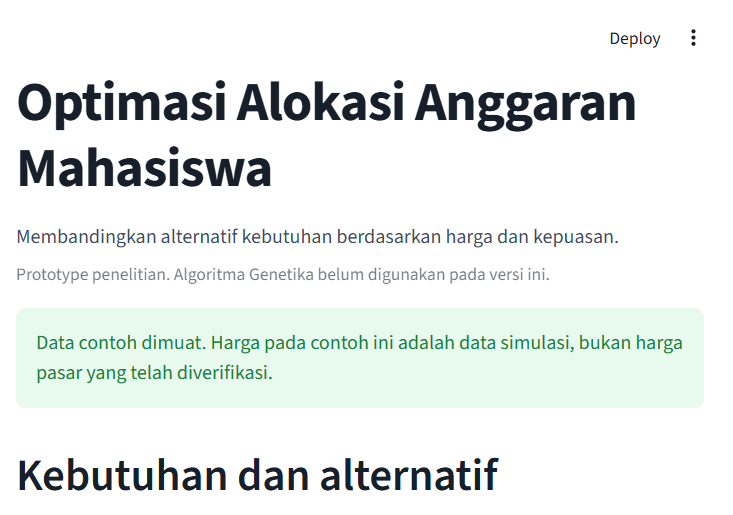
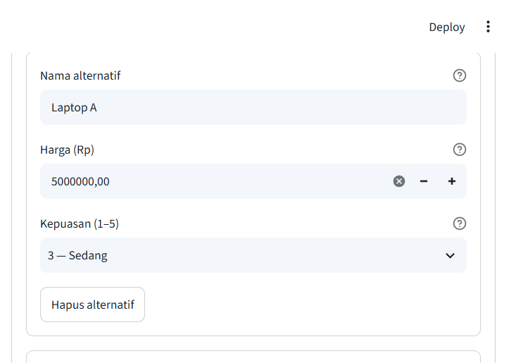
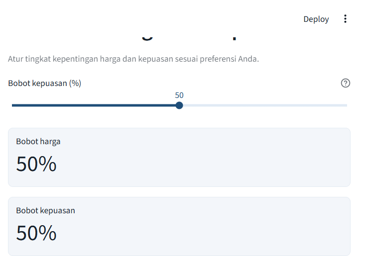
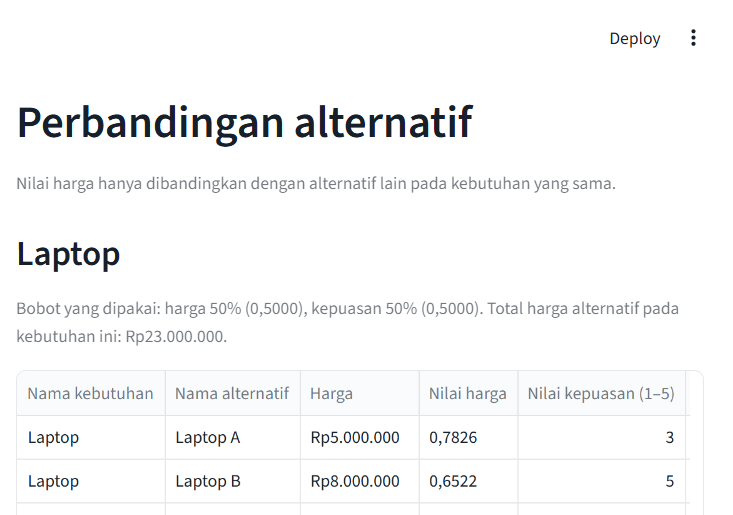
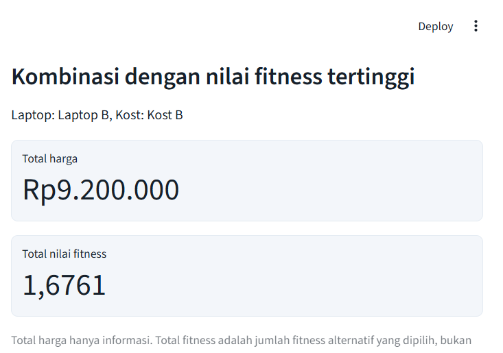

# Optimasi Alokasi Anggaran Mahasiswa

Aplikasi ini membantu mahasiswa membandingkan pilihan kebutuhan berdasarkan harga dan tingkat kepuasan. Pengguna memasukkan kebutuhan, alternatif, harga, dan kepuasan, lalu mengatur seberapa penting harga dibanding kepuasan. Aplikasi menghitung nilai tiap alternatif dan menyusun kombinasi yang dapat dibandingkan.

Aplikasi ini adalah **prototype penelitian** untuk topik *Optimasi Alokasi Anggaran Mahasiswa Menggunakan Algoritma Genetika*. Versi yang ada sekarang mengolah data alternatif dan menghitung fitness. **Algoritma Genetika belum dijalankan.** Hasil yang tampil bukan solusi optimal dari Algoritma Genetika.

## Gambaran aplikasi

Mahasiswa sering harus memilih beberapa kebutuhan sekaligus, misalnya laptop dan kost. Setiap kebutuhan punya beberapa alternatif dengan harga dan tingkat kepuasan yang berbeda.

Cara pakai secara ringkas:

1. Masukkan kebutuhan dan alternatifnya.
2. Isi harga serta kepuasan.
3. Atur bobot harga dan kepuasan.
4. Baca kombinasi dengan nilai fitness tertinggi, lalu bandingkan tabelnya.

Data yang dimasukkan:

- Nama kebutuhan, yaitu hal yang ingin dipenuhi.
- Nama alternatif, yaitu pilihan untuk kebutuhan itu.
- Harga alternatif, dalam rupiah.
- Kepuasan, skala 1 sampai 5.
- Bobot harga dan bobot kepuasan, yang jumlahnya selalu 100%.

Hasil yang ditampilkan:

- Kombinasi dengan nilai fitness tertinggi.
- Total harga kombinasi, sebagai informasi.
- Total nilai fitness.
- Tabel perbandingan alternatif: harga, kepuasan, nilai harga, skor kepuasan, bobot, dan fitness.
- Peringkat di dalam setiap kebutuhan.
- Daftar seluruh kombinasi, selama jumlahnya tidak melebihi 10.000.

Data hanya tersimpan selama sesi aplikasi terbuka. Menutup halaman atau memulai ulang aplikasi menghapus input. Tidak ada basis data.

## Fitur yang sudah tersedia

- Menambah, mengubah, dan menghapus kebutuhan serta alternatif.
- Validasi harga: kosong, nol, dan negatif ditolak.
- Normalisasi harga di dalam satu kebutuhan.
- Konversi kepuasan 1–5 menjadi skor 0–1.
- Pengaturan bobot harga dan kepuasan yang jumlahnya selalu 100%.
- Perhitungan fitness alternatif.
- Peringkat di dalam setiap kebutuhan.
- Pencacahan kombinasi dan total fitness, sampai 10.000 kombinasi.
- Data contoh simulasi untuk mencoba perhitungan.

## Panduan penggunaan

1. Masukkan kebutuhan, misalnya Laptop.
2. Tambahkan alternatif untuk kebutuhan itu, misalnya Laptop A.
3. Masukkan harga setiap alternatif. Ketik angka tanpa titik, misalnya `5000000` untuk Rp5.000.000.
4. Masukkan kepuasan dari 1 sampai 5. Angka 1 berarti sangat rendah, angka 5 berarti sangat tinggi.
5. Ulangi untuk kebutuhan lain, misalnya Kost.
6. Atur bobot harga dan kepuasan. Total keduanya selalu 100%.
7. Lihat hasil perhitungan. Kombinasi teratas adalah kombinasi dengan nilai fitness tertinggi pada bobot yang sedang dipakai.

Tombol **Muat Data Contoh** mengisi Laptop dan Kost dengan data simulasi agar perhitungan dapat dicoba langsung. Tombol itu mengganti input yang sedang ada. Harga pada data contoh bukan harga pasar.

Tombol **Hapus Semua Data** menghapus kebutuhan dan alternatif. Bobot tidak ikut diubah.

### Tampilan

Gambar berikut diambil dari aplikasi yang sedang berjalan, setelah data contoh dimuat dan bobot berada pada 50% serta 50%.











## Penjelasan perhitungan

Rumus di bawah ini adalah rumus yang dipakai kode saat ini, di dalam `perhitungan.py`.

### Nilai harga

Nilai harga dihitung **terpisah untuk setiap kebutuhan**. Pembaginya adalah total harga alternatif pada kebutuhan yang sama, bukan jumlah harga seluruh kebutuhan.

```text
H_i = 1 - (P_i / total harga alternatif pada kebutuhan yang sama)
```

- `H_i` adalah nilai harga alternatif.
- `P_i` adalah harga alternatif itu.
- Semakin kecil porsi harga terhadap total kebutuhannya, semakin besar nilai harganya.
- Nilai ini bukan persentase diskon.

### Skor kepuasan

Kepuasan diisi sebagai bilangan bulat 1 sampai 5, lalu diubah ke skor 0 sampai 1.

```text
S_i = (R_i - 1) / 4
```

- `S_i` adalah skor kepuasan.
- `R_i` adalah kepuasan yang dipilih.

| Kepuasan | Arti singkat | Skor |
| --- | --- | --- |
| 1 | Sangat rendah | 0,0000 |
| 2 | Rendah | 0,2500 |
| 3 | Sedang | 0,5000 |
| 4 | Tinggi | 0,7500 |
| 5 | Sangat tinggi | 1,0000 |

### Fitness alternatif

```text
F_i = (w_h × H_i) + (w_s × S_i)
```

- `F_i` adalah fitness alternatif.
- `w_h` adalah bobot harga.
- `w_s` adalah bobot kepuasan.
- `w_h + w_s = 1`.

Di aplikasi, slider mengatur bobot kepuasan dari 0% sampai 100%. Bobot harga = 100% − bobot kepuasan. Nilai awal keduanya 50%. Posisi 50% dan 50% adalah titik awal percobaan, bukan bobot yang sudah divalidasi secara ilmiah.

### Fitness kombinasi

Setiap kombinasi memilih tepat satu alternatif dari setiap kebutuhan.

```text
F_total = jumlah fitness dari alternatif yang dipilih pada setiap kebutuhan
```

Total fitness bukan persentase kepuasan dan bukan persentase penghematan. Nilainya hanya sebanding di antara kombinasi dengan set kebutuhan yang sama. Menambah kebutuhan menambah suku yang dijumlahkan.

Pada prototype ini belum ada batas anggaran. Karena fitness kombinasi hanya penjumlahan, kombinasi tertinggi saat ini tersusun dari alternatif tertinggi tiap kebutuhan jika tidak ada nilai yang seri. Setelah batas anggaran ada, hal itu tidak selalu benar.

Angka di aplikasi memakai empat angka desimal. Perhitungan memakai nilai penuh, lalu hasilnya dibulatkan saat ditampilkan.

### Contoh Laptop

Bobot harga 50% (`w_h = 0,5000`) dan bobot kepuasan 50% (`w_s = 0,5000`).

| Alternatif | Harga | Kepuasan |
| --- | --- | --- |
| Laptop A | Rp5.000.000 | 3 |
| Laptop B | Rp8.000.000 | 5 |
| Laptop C | Rp10.000.000 | 4 |

Total harga pada kebutuhan Laptop = Rp23.000.000.

Nilai harga:

- Laptop A: 1 − (5.000.000 / 23.000.000) = 0,7826
- Laptop B: 1 − (8.000.000 / 23.000.000) = 0,6522
- Laptop C: 1 − (10.000.000 / 23.000.000) = 0,5652

Skor kepuasan:

- Laptop A: (3 − 1) / 4 = 0,5000
- Laptop B: (5 − 1) / 4 = 1,0000
- Laptop C: (4 − 1) / 4 = 0,7500

Fitness:

- Laptop A: (0,5000 × 0,7826) + (0,5000 × 0,5000) = 0,6413
- Laptop B: (0,5000 × 0,6522) + (0,5000 × 1,0000) = 0,8261
- Laptop C: (0,5000 × 0,5652) + (0,5000 × 0,7500) = 0,6576

Di dalam kebutuhan Laptop, fitness tertinggi adalah Laptop B.

Data contoh juga berisi kebutuhan Kost:

| Alternatif | Harga | Kepuasan | Nilai harga | Skor kepuasan | Fitness |
| --- | --- | --- | --- | --- | --- |
| Kost A | Rp800.000 | 4 | 0,8000 | 0,7500 | 0,7750 |
| Kost B | Rp1.200.000 | 5 | 0,7000 | 1,0000 | 0,8500 |
| Kost C | Rp2.000.000 | 3 | 0,5000 | 0,5000 | 0,5000 |

Total harga alternatif Kost = Rp4.000.000. Fitness tertinggi di dalam Kost adalah Kost B.

Ada 9 kombinasi. Urutan berikut memakai bobot 50% dan 50%.

| Peringkat | Laptop | Kost | Total harga | Total fitness |
| --- | --- | --- | --- | --- |
| 1 | Laptop B | Kost B | Rp9.200.000 | 1,6761 |
| 2 | Laptop B | Kost A | Rp8.800.000 | 1,6011 |
| 3 | Laptop C | Kost B | Rp11.200.000 | 1,5076 |
| 4 | Laptop A | Kost B | Rp6.200.000 | 1,4913 |
| 5 | Laptop C | Kost A | Rp10.800.000 | 1,4326 |
| 6 | Laptop A | Kost A | Rp5.800.000 | 1,4163 |
| 7 | Laptop B | Kost C | Rp10.000.000 | 1,3261 |
| 8 | Laptop C | Kost C | Rp12.000.000 | 1,1576 |
| 9 | Laptop A | Kost C | Rp7.000.000 | 1,1413 |

Peringkat 1 berarti fitness 0,8261 + 0,8500 = 1,6761. Angka itu bukan 167,61% kepuasan. Total harga Rp9.200.000 juga bukan bukti bahwa anggaran terpenuhi, karena anggaran belum dimodelkan.

Contoh pemeriksaan rumus yang tidak bergantung pada input: harga 2.000, 3.000, dan 5.000 menghasilkan nilai harga 0,8000, 0,7000, dan 0,5000. Harga 7.000 dan 3.000 menghasilkan 0,3000 dan 0,7000. Jika nilai harga 0,8000, kepuasan 3, dan bobot 50:50, fitnessnya 0,6500.

## Aturan dan validasi input

- Nama kebutuhan dan nama alternatif tidak boleh kosong.
- Nama yang sama, tanpa membedakan huruf besar dan spasi berlebih, ditolak di dalam kelompoknya.
- Harga harus lebih besar dari nol.
- Harga negatif dan harga nol tidak diterima.
- Harga yang dikosongkan tidak diubah menjadi nol.
- Pesan harga yang tidak valid: "Harga harus lebih besar dari Rp0. Jika data belum diisi, lengkapi harga terlebih dahulu."
- Alternatif dengan data tidak valid tetap tampil agar dapat diperbaiki, tetapi tidak dipakai dalam perhitungan nilai harga, fitness, peringkat, atau kombinasi.
- Jika ada harga tidak valid pada suatu kebutuhan, kebutuhan itu tidak menghasilkan rekomendasi. Pembagian dengan nol tidak dilakukan.
- Kepuasan memakai skala bulat 1 sampai 5.
- Bobot harga dan bobot kepuasan berjumlah 100%.
- Kebutuhan tanpa alternatif belum dihitung.
- Satu alternatif dengan harga lebih dari nol tetap dihitung. Nilai harganya 0,0000 karena tidak ada pembanding, bukan karena harganya dinilai buruk.
- Kombinasi tidak disusun selama masih ada kebutuhan yang datanya belum valid.
- Jika jumlah kombinasi lebih dari 10.000, pencacahan tidak dijalankan.

## Batasan prototype

Yang sudah tersedia:

- Input, pengeditan, dan penghapusan kebutuhan serta alternatif.
- Validasi harga dan kepuasan.
- Normalisasi harga per kebutuhan.
- Konversi skor kepuasan.
- Pengaturan bobot harga dan kepuasan.
- Perhitungan fitness alternatif.
- Peringkat di dalam satu kebutuhan.
- Pencacahan kombinasi dan total fitness, sampai 10.000 kombinasi.
- Data contoh simulasi.

Yang belum tersedia:

- Implementasi Algoritma Genetika, termasuk seleksi, crossover, mutasi, dan generasi.
- Batas anggaran. Kombinasi dengan fitness tertinggi belum tentu kombinasi yang layak dibeli.
- Basis data, login, dan integrasi API.
- Penyimpanan permanen. Input hilang saat sesi berakhir.

Karena itu, hasil perhitungan **tidak boleh disebut hasil optimasi Algoritma Genetika**.

Batasan lain:

- Kombinasi dicacah satu per satu, bukan dicari dengan optimasi.
- Bobot awal 50:50 belum divalidasi sebagai bobot ilmiah final.
- Data contoh adalah simulasi.
- Nilai harga tidak dibandingkan mentah antar kebutuhan, karena pembaginya berbeda.
- Total fitness dari dua set kebutuhan yang berbeda tidak disetarakan.

## Instalasi dan penggunaan lokal

Perangkat lunak:

- Windows
- Python 3.10 atau lebih baru
- Koneksi internet saat memasang dependensi

Struktur proyek:

```text
app.py
perhitungan.py
requirements.txt
README.md
.gitignore
.streamlit/
    config.toml
tests/
    test_perhitungan.py
docs/
    screenshots/
```

`app.py` hanya menampilkan antarmuka. Rumus ada di `perhitungan.py`. Keduanya tetap terpisah.

Folder `.venv/`, `__pycache__/`, dan `.pytest_cache/` boleh tetap ada di komputer, tetapi tidak diunggah. `.gitignore` sudah mengabaikannya. Folder `.venv` tidak dihapus oleh proyek ini. Setelah pengujian selesai, folder itu dapat dihapus sendiri jika environment ingin dibuat ulang.

Buka PowerShell di folder proyek, lalu jalankan:

```powershell
py -3 -m venv .venv
.\.venv\Scripts\python.exe -m pip install -r requirements.txt
.\.venv\Scripts\python.exe -m streamlit run app.py
```

Jika perintah `py` tidak dikenali, ganti `py -3` dengan `python`.

Streamlit menampilkan alamat lokal, biasanya `http://localhost:8501`. Buka alamat itu di peramban. Jangan menjalankan aplikasi dengan `python app.py`.

Dependensi pada `requirements.txt`:

- Streamlit, untuk antarmuka
- Pandas, untuk tabel
- Matplotlib, untuk diagram fitness
- Pytest, untuk pengujian perhitungan secara lokal

Pengujian dijalankan dari folder proyek:

```powershell
.\.venv\Scripts\python.exe -m pytest -v
```

Jika environment sudah aktif, perintah yang sama adalah:

```powershell
python -m pytest -v
```

Pytest tercantum di `requirements.txt` bersama dependensi aplikasi, jadi satu kali `pip install -r requirements.txt` cukup untuk menjalankan aplikasi dan pengujian. Pytest tidak dipanggil saat aplikasi dibuka.

Pengujian memeriksa nilai harga, skor kepuasan, fitness pada bobot 50:50, jumlah fitness kombinasi, jumlah bobot yang selalu 1, penolakan harga nol dan negatif, harga kosong, serta pembatalan pencacahan di atas 10.000 kombinasi. Ekspektasi pengujian tidak diubah pada perapihan struktur ini.

## Deployment

Panduan ini menyiapkan unggahan ke [Streamlit Community Cloud](https://share.streamlit.io) melalui GitHub. Langkah unggah dilakukan sendiri oleh pengembang. Repository tidak diunggah secara otomatis dari dokumen ini.

### Menyiapkan repository GitHub

1. Buat repository baru di GitHub. Repository dapat bersifat publik agar Community Cloud gratis dapat membacanya, atau privat jika akun Streamlit sudah terhubung ke repository privat.
2. Jangan unggah folder `.venv/`, `__pycache__/`, atau file rahasia. `.gitignore` sudah mengabaikan berkas itu.
3. Sertakan berkas yang dibutuhkan aplikasi:
   - `app.py`
   - `perhitungan.py`
   - `requirements.txt`
   - `README.md`
   - `.streamlit/config.toml`
   - `docs/screenshots/`, jika gambar panduan ingin ikut tampil di README
   - `tests/`, jika pengujian ingin ikut tersimpan di repository
4. Dari folder proyek, contoh perintah setelah Git terpasang dan repository sudah dibuat:

```powershell
git init
git add .
git commit -m "Siapkan prototype perhitungan anggaran mahasiswa"
git branch -M main
git remote add origin https://github.com/NAMA-AKUN/NAMA-REPOSITORY.git
git push -u origin main
```

Ganti alamat `origin` dengan alamat repository yang benar. Periksa `git status` sebelum commit agar folder virtual environment tidak ikut terunggah.

### Menghubungkan ke Streamlit Community Cloud

1. Buka [share.streamlit.io](https://share.streamlit.io) dan masuk dengan akun GitHub.
2. Pilih **Create app**.
3. Pilih repository, branch (`main`), dan file utama aplikasi: `app.py`.
4. Biarkan Python bawaan Community Cloud. Kode ini berjalan pada Python 3.10 atau lebih baru dan tidak membutuhkan versi khusus komputer pengembang.
5. Deploy. Community Cloud memasang paket dari `requirements.txt`, lalu menjalankan `streamlit run app.py`.
6. Setelah selesai, salin URL aplikasi. Bentuknya biasanya `https://nama-app.streamlit.app`.

Tidak ada secret, basis data, atau path absolut komputer pengembang. Konfigurasi di `.streamlit/config.toml` hanya mengatur warna dan mematikan statistik penggunaan.

### Memperbarui aplikasi

1. Ubah kode di komputer.
2. Commit perubahan, lalu push ke branch yang sama.
3. Community Cloud membangun ulang aplikasi dari commit terbaru. Jika tidak langsung berubah, buka menu aplikasi di Community Cloud dan pilih **Reboot** atau tunggu proses deploy selesai.
4. Buka kembali URL yang sama untuk melihat versi baru.

Data pengguna tetap tidak tersimpan permanen setelah aplikasi dimulai ulang.
